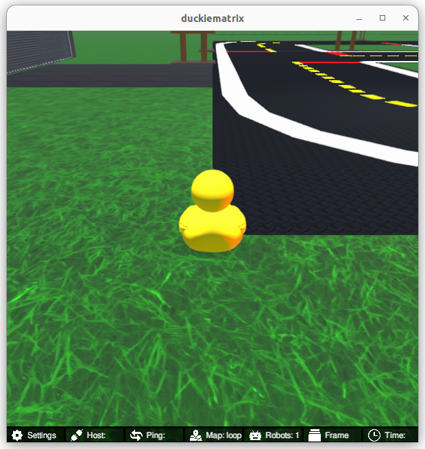
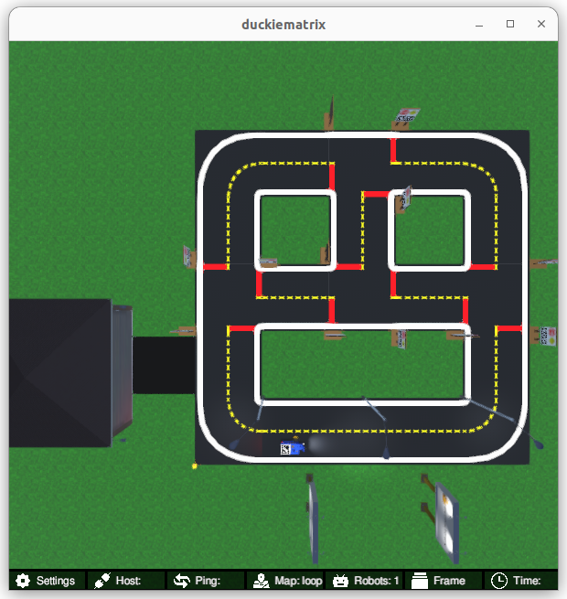

<p align="center">
<a href="https://duckietown.com"></a>
</p>

# Learning Experience (LX): Kinematics and Odometry

Find the most up-to-date instructions on [how to run LXs on the Duckietown manual](https://docs.duckietown.com/ente/duckietown-manual/60-learning-experiences/lx-general-procedure.html). 

# Introduction

In this learning experience you will learn how we can move between reference frames, how we can use this to build a model of how the robot moves (kinematics), and how this can be used to build a model of how the robot moves over time based on the data coming from the wheel encoders (odometry estimation).

# Instructions

**NOTE:** All commands below are intended to be executed from the root directory of this exercise (i.e., the directory containing this `README`).


## 1. Make sure your exercise is up-to-date

Update your exercise definition and instructions,

    git pull upstream ente

**NOTE:** to pull from upstream, you need to have completed the instructions in the [general procedure for running learning experiences in the Duckietown manual](https://docs.duckietown.com/ente/duckietown-manual/60-learning-experiences/lx-general-procedure.html) to *fork* this repository.


## 2. Make sure your system is up-to-date

- 💻 Always make sure your Duckietown Shell is updated to the latest version: `pipx upgrade duckietown-shell` (see the [installation instructions](https://docs.duckietown.com/ente/duckietown-manual/10-setup/02-software/duckietown-shell-dts-installation.html))

- 💻 Update the shell commands: `dts update`

- 💻 Make sure all the Docker images on your computer are up to date: `dts desktop update`

- 🚙 Make sure all the Docker images on your Duckiebot are up to date: `dts duckiebot update ROBOTNAME` (where `ROBOTNAME` is the name of your (real or virtual - more on this later) Duckiebot chosen during the initialization procedure.)


## 3. Work on the exercise


### Launch the code editor

Open the code editor by running the following command,

```
dts code editor
```

Wait for a URL to appear on the terminal, then click on it or copy-paste it in the address bar
of your browser to access the code editor. The first thing you will see in the code editor is
this same document, you can continue there.


### Walkthrough of notebooks

**NOTE**: You should be reading this from inside the code editor in your browser.

Inside the code editor, use the navigator sidebar on the left-hand side to navigate to the
`notebooks` directory and open the first notebook.

Follow the instructions on the notebook and work through the notebooks in sequence.

Once you have completed all the tasks in the notebooks, you can follow the instructions below to test your code.


## 4. Run your code


### Testing with the Duckiematrix (optional)

It can be useful to test your code in a simulated environment before trying it on the real robot. For this, we have the Duckiematrix.

In order to test your code in the Duckiematrix you will need a virtual robot. You can create one with the command:

```
dts duckiebot virtual create --type duckiebot --configuration DB21J [VIRTUAL_ROBOT_NAME]
```

where `[VIRTUAL_ROBOT_NAME]` can be anything you like (but remember it for later).

Then you can start your virtual robot with the command:

```
dts duckiebot virtual start [VIRTUAL_ROBOT_NAME]
```

You should see it with a status `Booting` and finally `Ready` if you look at `dts fleet discover`: 

```
     | Hardware |   Type    | Model |  Status  | Hostname 
---  | -------- | --------- | ----- | -------- | ---------
vbot |  virtual | duckiebot | DB21J |  Ready   | vbot.local
```

Now that your virtual robot is ready you can start the Duckiematrix. From this exercise directory do:

```
dts code start_matrix
```

You should see the Unity-based Duckiematrix simulator start up. The start screen will look like this:



From here, you can click anywhere in the window and press [ENTER] to activate it. You can then move the little duck towards the Duckiebot with the `w`, `a`, `s` and `d` keys, or use the mouse to change the camera angle and look at the Duckiebot. You can also switch to a top-down view by pressing `v`, which gives a view similar to this one:




### Building your code

You can build your code with 

```
dts code build -R ROBOT_NAME
```

This will build a docker image with your code compiled inside - you should see your ROS 2 package get built during the process. 


### Starting the ROS 2 stack of your robot

This exercise runs on the ROS 2 stack of the robot. Virtual robots still boot with the ROS 1 stack by default, so
the ROS 2 stack has to be started explicitly (this is needed once per boot, for both virtual and real robots):

```
dts stack up -R [ROBOT_NAME] ros2/duckiebot
dts stack up -R [ROBOT_NAME] ros2-core/default
```

where `[ROBOT_NAME]` is the name of your real or virtual robot.


### 💻 Testing 


You can then run your code with:

```
dts code workbench [-m] -R [ROBOT_NAME]
```

where `[ROBOT_NAME]` can be a real or a virtual robot; if it is a virtual robot you must add the `-m` option to indicate that you want to test it in the Duckiematrix.

The workbench runs your `encoder_pose_node` against the robot and streams its logs to the terminal. 
The code editor is your window on the robot: the notebooks contain panels that plot the odometry you are 
calculating, show what the robot sees and let you drive it (a virtual joystick), and a terminal opened inside the 
editor (menu > Terminal > New Terminal) has the ROS 2 command line tools, e.g.

```
ros2 topic list
ros2 topic echo /[ROBOT_NAME]/left_wheel_encoder_driver_node/tick
ros2 node list
ros2 param list /[ROBOT_NAME]/encoder_pose_node
ros2 param set /[ROBOT_NAME]/encoder_pose_node verbose false
ros2 service call /[ROBOT_NAME]/encoder_pose_node/reset std_srvs/srv/Trigger
```

The editor connects to your robot when it knows its name: the notebooks do it with the `ros = RosSession(ROBOT)` cell;
in a terminal, run `dt-ros2-connect [ROBOT_NAME]` first.

Troubleshooting:

- `ros2 topic list` / `ros2 node list` come back empty: the graph takes a few seconds to sync through the robot's 
  zenoh router, use `ros2 topic list --no-daemon --spin-time 5` (same for `ros2 node list`).
- the robot does not move with the virtual joystick: check which topic the kinematics node of your robot listens to 
  with `ros2 node info /[ROBOT_NAME]/kinematics_node`. The joystick publishes on `/[ROBOT_NAME]/car_cmd_switch_node/cmd`; 
  older robot images listen on `/[ROBOT_NAME]/car_cmd`, in that case use `Joystick(ros, topic="car_cmd")` in the notebook.

Now you can proceed to the [first notebook](./notebooks/01-Representations/pose_representation.ipynb).


## Credits

This exercise benefited from significant contributions by [Rey Reza Wiyatno](https://rrwiyatn.github.io/).
